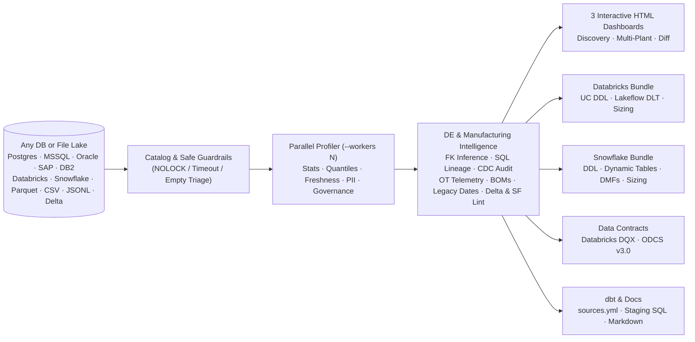

# tick — Universal Automatic Database Discovery for Data Engineering, Databricks & Snowflake

[](https://github.com/henrikbernard/tick/actions/workflows/ci.yml)
[](https://www.python.org/downloads/)
[](https://opensource.org/licenses/MIT)

`tick` points at **any SQLAlchemy-supported database** (**PostgreSQL, SQL Server, DuckDB, SQLite, MySQL/MariaDB, Databricks Unity Catalog, Snowflake, Oracle, IBM DB2/AS400, SAP HANA, BigQuery**) OR **local/data-lake files & landing zones** (**Parquet, CSV, TSV, JSON/JSONL, `.gz`, Hive-partitioned directories, Delta Lake**) and automatically discovers everything a data engineer needs before building pipelines—with first-class **Databricks Lakehouse**, **Snowflake Data Cloud**, **Manufacturing / ERP / MES / OT**, **Data Contracts**, and **standalone offline HTML dashboards**.



---

## Key Capabilities

### 1. Core Discovery, File Lake Scanning, Profiling & Lineage
- **Universal Schema Catalog & File Lake Mounting**: Introspects RDBMS schemas, tables, views, materialized views, PKs, FKs, indexes, row counts, and sizes—OR point `tick discover` directly at a single file, glob (`./drop/*.csv`), Hive-partitioned folder, Delta Lake directory, or multi-format landing zone (`.parquet`, `.csv`, `.tsv`, `.json`, `.jsonl`, `.gz`).
- **Parallel Data Profiling (`--workers N`)**: Bounded thread-pool profiling for large ERP databases with null rates, distinct counts, cardinality classes, min/max, numeric mean/stddev/quantiles (`p25`/`p50`/`p75`), string lengths, top-K frequencies, and timestamp freshness/staleness checks.
- **Relationship & View SQL Lineage**: Collects explicit FKs, infers missing/unenforced joins with value-overlap verification, and parses view SQL via `sqlglot` for multi-hop lineage graphs.
- **Data Engineering Blueprint**: Classifies entity roles (`fact`, `dimension`, `event_log`, `bridge`, `reference`, `staging`, `view`), recommends ingestion strategies, watermarks, candidate PKs, and 0–100 table health scores.

### 2. Three Standalone Offline HTML Dashboards *(zero external CDNs)*
- **Discovery Dashboard (`tick discover --html`)**:
  - Overview KPIs, inline SVG **CDC Readiness Donut**, Health & Entity Role charts, and a 3-tier **Databricks Migration Wave Planner** (Wave 1 Fast-Track / Wave 2 Needs Config / Wave 3 Remediation Required) with Bronze MB/GB & daily row rollups.
  - Interactive **Catalog & Profiler** with column search/PII/null filters, inline SVG **Numeric Quantile Boxplots**, and proportional **Top-Value Bars**.
  - **Interactive ERD & Lineage DAG** with drag-to-pan, scroll-wheel zoom, live highlight search, Fit View, cycle handling, and one-click **Download SVG**.
  - Persisted Light/Dark theme toggle, **Print / PDF** executive summary layout, and downloadable Unity Catalog DDL / Lakeflow DLT / Snowflake DDL / Dynamic Tables / DMFs / dbt code.
- **Multi-Plant Harmonization Dashboard (`tick compare-sources --html`)**:
  - Interactive **Plant × Table Presence & Drift Heatmap**, alignment donut, drift breakdown bars, click-to-inspect column conflict & cast matrices, and copy/download **Unified Multi-Plant Databricks or Snowflake (`--target snowflake`) `UNION ALL` SQL**.
- **Schema & Data Drift Dashboard (`tick diff --html`)**:
  - Breaking vs Safe CI gate banner, added/removed tables & PK change lists, filterable column diffs (including breaking type narrowings), newly detected PII alerts, and Before vs After metric drift bars.

### 3. Databricks & Snowflake Target Readiness (`--target databricks | snowflake | both`)
- **Unity Catalog & Snowflake Connectors**: Connect directly to Databricks SQL Warehouses (`databricks://...`) or Snowflake (`snowflake://...`) alongside upstream OLTP/ERP databases (`SAMPLE (N ROWS)`, `INFORMATION_SCHEMA.TABLES`, `STATEMENT_TIMEOUT_IN_SECONDS`).
- **CDC Readiness Audit**: Inspects SQL Server Change Tracking/CDC, PostgreSQL `wal_level`/`REPLICA IDENTITY`, Oracle `ARCHIVELOG`/supplemental logging, MySQL `binlog_format`, Snowflake Streams/Change Tracking, PK presence, and unsupported column types.
- **Dual-Platform Compatibility Linters**:
  - **Spark / Delta Lake**: Flags illegal column names, `DECIMAL` > 38, `MONEY`/exotic types, timezone-naive `TIMESTAMP_NTZ`, and recommends **Liquid Clustering (`CLUSTER BY`)**.
  - **Snowflake**: Maps native `NUMBER`/`TIMESTAMP_NTZ`/`TIMESTAMP_LTZ`/`TIME`/`VARIANT`/`GEOGRAPHY`, flags quoted identifiers, `NUMBER` > 38, `VARIANT` 16 MB limits, Automatic Clustering cost advisories, and Virtual Warehouse sizing (`XSMALL`–`LARGE`).
- **Databricks Asset Bundle (`--databricks-dir`)**:
  - `unity_catalog_ddl.sql`: Delta `CREATE TABLE` with Liquid Clustering, CDF, Deletion Vectors, UC tags, and type-matched row-filter / column-mask templates.
  - `lakeflow_pipeline.py`: Ready-to-run **Lakeflow Declarative Pipelines (DLT)** Bronze → Silver Python with atomic column renaming, legacy date stitching, `@dlt.expect_all`, `dlt.apply_changes`, batch Materialized Views, and streaming watermarks.
  - `ingestion_sizing.md`: Backfill size, daily velocity, cadence, and Databricks compute tier plan.
- **Snowflake Asset Bundle (`--snowflake-dir`)**:
  - `snowflake_ddl.sql`: `CREATE TABLE` with `CHANGE_TRACKING = TRUE`, Object Tags (`CREATE TAG`), type-matched **Row Access Policies** (multi-plant isolation), and type-matched **Dynamic Data Masking Policies** (PII / cost / ITAR).
  - `snowflake_dynamic_tables.sql`: Bronze → Silver **Snowflake Dynamic Tables** (`TARGET_LAG`, `WAREHOUSE`, native `TRY_TO_TIMESTAMP_NTZ` / `DATEADD` legacy date parsing, OT quality `WHERE` filters, and `QUALIFY ROW_NUMBER()` deduplication).
  - `snowflake_dmf.sql`: **Snowflake Data Metric Functions (DMFs)** (`SNOWFLAKE.CORE.ROW_COUNT`, `DUPLICATE_COUNT`, `NULL_COUNT`, `FRESHNESS`, plus custom `BAD_OPC_QUALITY_COUNT` for numeric OPC Classic sensors).
  - `snowflake_sizing.md`: Openflow / Snowpipe Streaming / COPY INTO connector plan, Dynamic Table lag, clustering advisory, and Virtual Warehouse sizing.
- **Data Contract Exporter (`--contracts-dir`)**:
  - `dqx_checks.yml`: **Databricks Labs DQX** quality checks (`is_unique`, `is_not_null`, `is_in_list`, `is_in_range`, OT quality checks) with sensitive values excluded.
  - `data_contract.odcs.yml`: **Open Data Contract Standard (ODCS v3.0.0)** YAML targeting Databricks, Snowflake, or both.

### 4. Manufacturing, ERP & OT Intelligence
- **Production Shop-Floor Safety Guardrails**: `--read-uncommitted` (`WITH (NOLOCK)` / `WITH UR`), `--query-timeout`, `--skip-empty-tables`, `--skip-tables-over-mb`, `--use-tablesample`, and credential masking in URLs/ODBC strings.
- **ERP / SAP Semantic Glossary**: Built-in SAP/MES glossary (`MARA`, `AUFK`, `WERKS`, `MATNR`, `STPRS`, etc.), automatic SAP `DD02T`/`DD03T` extraction, and custom `--glossary custom.yml` overrides.
- **Legacy Date/Time Detection**: `YYYYMMDD`, JDE/SAP Julian (`CYYDDD`/`YYYYDDD`), Excel serial dates, `HHMMSS`, and split DATE + TIME pairs (`ERDAT` + `ERZET`) with PySpark stitching expressions.
- **OT Historian & PLC Telemetry**: Narrow EAV tag tables & wide PLC polling tables, per-tag polling cadence, flatlined sensor detection, OPC Classic/UA bad quality code rates, and watermark delay recommendations.
- **Recursive BOM & Lot Genealogy**: Detects self-referential parent/child part, lot, work-order, and asset trees.
- **Manufacturing Governance**: Plant isolation keys (`plant_id`, `WERKS` → UC row filters), commercial pricing/cost (`unit_cost`, `STPRS` → UC column masks), and ITAR/CAD/IP (`cad_drawing_path` → UC compliance tags).

---

## Installation

```bash
git clone https://github.com/henrikbernard/tick.git
cd tick
pip install -e .

# Optional database drivers:
pip install -e ".[duckdb]"      # DuckDB
pip install -e ".[databricks]"  # Databricks Unity Catalog SQL Warehouse
pip install -e ".[postgres]"    # PostgreSQL (psycopg3)
pip install -e ".[mssql]"       # SQL Server (pyodbc)
pip install -e ".[oracle]"      # Oracle (oracledb)
pip install -e ".[mysql]"       # MySQL / MariaDB (pymysql)
pip install -e ".[db2]"         # IBM DB2 / AS400
pip install -e ".[hana]"        # SAP HANA
pip install -e ".[snowflake]"   # Snowflake
pip install -e ".[bigquery]"    # BigQuery
```

---

## Quick Start

```bash
# 1. Check installed SQLAlchemy database drivers
tick drivers

# 2. Generate Smart Factory (SAP + MES + OT Historian + BOM) demos for two plants
tick demo ./plant_ohio.duckdb --domain manufacturing --plant plant_ohio
tick demo ./plant_munich.duckdb --domain manufacturing --plant plant_munich

# 3. Discover Plant Ohio with parallel workers, safety guardrails, and full artifact bundle
#    Writes: report.html, report.md, snapshot.json, dbt/, databricks/, snowflake/, contracts/
#    (Add `--target snowflake` or `--target databricks` to emit only one cloud platform)
tick discover ./plant_ohio.duckdb \
  --out-dir ./ohio-discovery \
  --workers 4 \
  --skip-empty-tables \
  --use-tablesample \
  --databricks-catalog manufacturing \
  --databricks-schema bronze_ohio \
  --snowflake-db MANUFACTURING \
  --snowflake-schema BRONZE_OHIO \
  --snowflake-warehouse COMPUTE_WH

# 4. Discover Plant Munich
tick discover ./plant_munich.duckdb --out-dir ./munich-discovery --workers 4 --quiet

# 5. Harmonize schemas across plants & generate interactive HTML dashboard + unified SQL
#    (Add `--use-glossary` or `--glossary custom.yml` to unify heterogeneous ERP/MES names like SAP AUFK <-> MES work_orders;
#     pass `--target snowflake --database MANUFACTURING` to generate Snowflake UNION ALL views)
tick compare-sources ./ohio-discovery/snapshot.json ./munich-discovery/snapshot.json \
  --target databricks \
  --use-glossary \
  --html ./harmonization.html \
  --md ./harmonization.md \
  --sql ./unified_silver_views.sql

# 6. Compare snapshots for CI schema drift & breaking change gating
tick diff ./ohio-discovery/snapshot.json ./munich-discovery/snapshot.json \
  --html ./drift.html \
  --md ./drift.md \
  --fail-on-breaking

# 7. Discover a multi-format Data Lake / SFTP file landing zone (Parquet, CSV, JSONL, Hive partitions)
tick demo ./lake_drop --domain files
tick discover ./lake_drop --out-dir ./lake-discovery
```

---

## Output Bundle (`tick discover -o <dir>`)

| Artifact | Purpose |
|---|---|
| `report.html` | Standalone interactive Discovery Dashboard (Overview charts, Wave Planner, Catalog, ERD, Lineage, Quality, Code) |
| `report.md` | GitHub-flavored Markdown data dictionary with Mermaid ERD & Lineage diagrams |
| `snapshot.json` | Machine-readable Pydantic snapshot for `tick diff` and `tick compare-sources` |
| `databricks/unity_catalog_ddl.sql` | Unity Catalog Delta DDL with Liquid Clustering, CDF, tags, and type-matched mask/row-filter stubs |
| `databricks/lakeflow_pipeline.py` | Databricks Lakeflow Declarative Pipeline (DLT) Bronze → Silver Python code (uses Auto Loader `cloudFiles` for files) |
| `databricks/autoloader_ingest.sql` | Databricks SQL `COPY INTO` / Volume / `SHALLOW CLONE` ingestion script *(emitted for file sources)* |
| `databricks/gold_hierarchies.sql` | Recursive CTE Gold Delta SQL for detected BOMs, lot genealogy & asset trees (cycle-safe, plant-scoped) |
| `databricks/databricks.yml` | Deployment-ready **Databricks Asset Bundle (DABs)** manifest (`dev`/`prod` jobs, serverless DLT & dashboard) |
| `databricks/lakeview_dashboard.lvdash.json` | **Databricks AI/BI Lakeview** operational & manufacturing dashboard definition |
| `databricks/ingestion_sizing.md` | Backfill volume, daily row velocity, cadence, CDC audit, and Delta linter report |
| `snowflake/snowflake_ddl.sql` | Snowflake `CREATE TABLE` with `CHANGE_TRACKING`, Object Tags, Row Access Policies & Masking Policies |
| `snowflake/snowflake_file_ingest.sql` | Snowflake `CREATE FILE FORMAT`, `STAGE`, `COPY INTO` & Snowpipe templates *(emitted for file sources)* |
| `snowflake/snowflake_dynamic_tables.sql` | Bronze → Silver Snowflake Dynamic Tables with `TARGET_LAG`, legacy dates, OT filters & `QUALIFY` dedup |
| `snowflake/snowflake_gold_hierarchies.sql` | Recursive CTE Gold Dynamic Tables for BOMs, lot genealogy & asset trees (`ARRAY_CONTAINS` cycle guard) |
| `snowflake/snowflake_dmf.sql` | Snowflake Data Metric Functions (DMFs) for row count, nulls, duplicates, freshness & OPC quality |
| `snowflake/snowflake.yml` | Deployment-ready **Snowflake CLI (`snow`) v2** project manifest |
| `snowflake/streamlit_app.py` | **Streamlit in Snowflake (SiS)** observability, Dynamic Table lag, DMF, OT telemetry & BOM monitor app |
| `snowflake/snowflake_sizing.md` | Snowflake connector, Dynamic Table lag, clustering advisory, and Virtual Warehouse sizing plan |
| `contracts/dqx_checks.yml` | Databricks Labs DQX data quality rules YAML |
| `contracts/data_contract.odcs.yml` | Open Data Contract Standard (ODCS v3.0.0) YAML contract |
| `dbt/sources.yml` + `dbt/staging/*.sql` | dbt v2 sources with freshness/tests and clean staging SQL models |

---

## Development & Testing

```bash
pip install -e ".[dev]"
pytest -v
```
